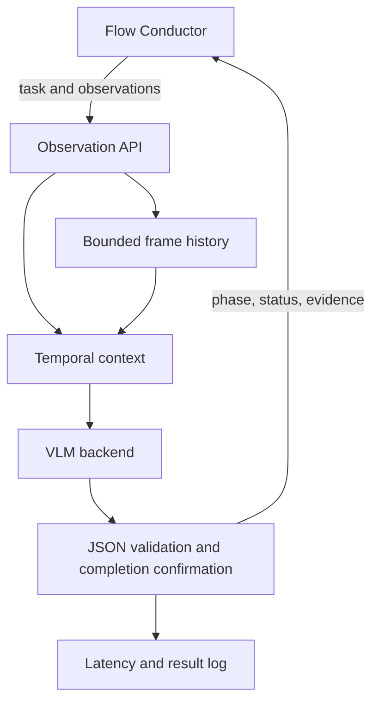

# Architecture

The task is loaded from TOML at service startup. FC sends observations to `/observe`.
The agent supplies up to `history_size` previous observations plus the current observation, and one
initial scene image once its observation has left the rolling window. The first image should be a stable
overview camera. The reference is cleared on reset and supplies initial support locations, not later
action evidence. Reserve one extra image in the serving budget (continuous review uses at most seven).
Each observation can include up to four views; the model server must support the total image count.
History uses CPU memory, storing image data URLs, not GPU KV tensors.

Stable prefix: system instructions + task description + phase criteria.
Dynamic suffix: initial reference when needed + retained observations + current observation + controller memory.
Previous model judgments are not replayed: their descriptions can anchor the model to obsolete poses.

Stage recognition is allowed to report any stage, including regressions and `unknown`.
A high-confidence completed verdict contributes one confirmation on a distinct observation. Counts are
independent per phase; `completion_confirmations` is the required count, not a consecutive-frame streak.
Changing phases, continued motion, occlusion, low confidence or a backend error neither adds a confirmation
nor erases earlier ones. An explicit failed verdict resets that phase's pending count; only a
high-confidence failure revokes an accepted completion. Reset clears all counts and accepted outcomes.
`phase_confirmation_counts` exposes a copy of the per-phase counts, capped at the configured threshold.
Moving to another phase does not confirm the preceding phase. Each phase is recorded independently:
missing phase 3 must not prevent a visibly completed phase 4 from being remembered. This does not permit
FC to skip phase 3; `WorkflowTracker` still enforces ordered execution. Confirmations survive occlusion.
A high-confidence explicit failure invalidates the reported phase and is remembered until that phase is
reconfirmed or the episode resets. Unknown-phase failure blocks overall success until reset/FC review.
`task_completed` requires every configured phase to be confirmed and no unresolved failure.

Low-confidence `in_progress`, `completed`, or `uncertain` verdicts receive an
`uncertainty_patience` observation grace window. They cannot confirm completion. A persistent confidence
dip becomes `review`; a failed verdict bypasses the grace window so a possible safety event is never
silently continued. Results expose the streak, grace state, confirmed phase, and ordered completed phases.

`expected_phase`, when supplied by FC, is an intent to verify rather than a label to copy. The model may
contradict it when visual evidence shows another phase. `WorkflowTracker` consumes final episode results,
accepts only the expected ordered phase, and carries only phase/retry state across episodes. Images and
model history remain isolated per episode. Retryable local errors stay on the phase; lost object state
requests replanning; terminal errors or an exhausted retry budget fail the workflow.

For segmented workflows, FC can instantiate a critic with only the requested phase and its criteria.
This turns each episode into focused completion/failure verification while `WorkflowTracker` retains the
global phase order. The five-stage video demo uses this mode and never carries images across episodes.
An explicit `end_of_episode` observation may accept one high-confidence completed verdict for the final
phase because no later frame exists; it never bypasses confirmation for an intermediate phase.
`is_terminal` is an input alias for `end_of_episode`; both must be booleans and agree when supplied together.
On termination, the controller returns `overall_status=success` only if all phases are confirmed without
unresolved failures. Otherwise it returns `overall_status=failed`, `decision=fail`, `recommendation=stop`,
and `overall_reason=PHASE_FAILED` or `INCOMPLETE_AT_END`. Visual `status/errors` remain unchanged: missing
evidence is not a fabricated physical failure. `failed_phases` lists unresolved high-confidence failures.
Before termination `overall_status=in_progress` and `overall_reason=null`. After termination, observe
rejects additional frames until reset. A backend error at termination still produces an overall failure
if the required completions are missing. FC remains responsible for actuation and replanning.

The G1, fast G1 and Vega task prompts share function-based success/failure criteria. Phase 3 requires
only the pipette tip aligned above the held tube opening, per the updated user definition. It does not
verify pressing or liquid transfer. Phases 4/5 require stable support after release.
The existing `uncertain` status represents UNKNOWN; phase names and task IDs remain compatible.
Offline video entrypoints default to 2 Hz source sampling (not inference throughput). Shorter interactions
may still be missed; increase sampling or add a camera that shows actuation. Continuous review keeps one
prior observation to fit the deployed eight-image limit for multi-view input; it is not a full tracker.
Use a fresh output directory for every prompt evaluation; saved predictions are never silently reused.
`--sample-id success_02 --sample-id failure_05` selects the two relevant continuous review examples.

Transport/parsing errors produce `uncertain`, preserve prior confirmation counts and retain the frame.
Bad input or mismatched episode returns HTTP 400 without consuming a frame.
Backend errors return HTTP 200 with an uncertain judgment and `backend_error_type`.
`/health` tests process availability, not model readiness.

Latency currently covers agent context construction, model round trip, parsing and state update.
It excludes camera capture, client encoding, inbound HTTP, outbound HTTP and robot control.
`inference_and_parse_ms` also includes prompt construction; it is not pure GPU kernel time.
Offline continuous evaluation runs observations sequentially within each episode but defaults to two
episodes in parallel, allowing vLLM to batch independent requests without breaking temporal state.
Offline replay writes JSONL. HTTP clients must persist returned results themselves.
