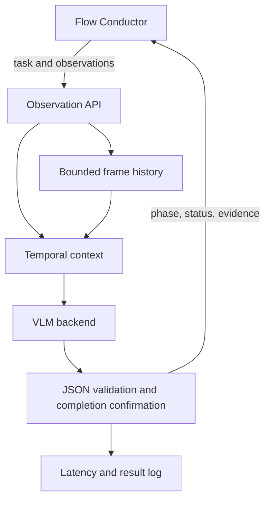

# Architecture

The task is loaded from TOML at service startup. FC sends observations to `/observe`.
The agent supplies up to `history_size` previous observations plus the current observation.
Each observation can include up to four views; the model server must support the total image count.
History uses CPU memory, storing image data URLs, not GPU KV tensors.

Stable prefix: system instructions + task description + phase criteria.
Dynamic suffix: retained observations + current observation + previous model judgment.
The previous judgment is a hint and may be wrong; it must never substitute for current evidence.

Stage recognition is allowed to report any stage, including regressions and `unknown`.
A high-confidence completed verdict needs consecutive distinct frames to be confirmed.
Only ordered phase confirmations contribute to full-task completion. An out-of-order completion
produces a review recommendation. Prior confirmations are latched until reset; rework/invalidation
semantics need to be agreed with FC before real deployment.
Final completion is emitted only while the final phase is confirmed and all phases were accepted.

Transport/parsing errors produce `uncertain`, reset the confirmation streak and retain the frame.
Bad input or mismatched episode returns HTTP 400 without consuming a frame.
Backend errors return HTTP 200 with an uncertain judgment and `backend_error_type`.
`/health` tests process availability, not model readiness.

Latency currently covers agent context construction, model round trip, parsing and state update.
It excludes camera capture, client encoding, inbound HTTP, outbound HTTP and robot control.
`inference_and_parse_ms` also includes prompt construction; it is not pure GPU kernel time.
Offline replay writes JSONL. HTTP clients must persist returned results themselves.
